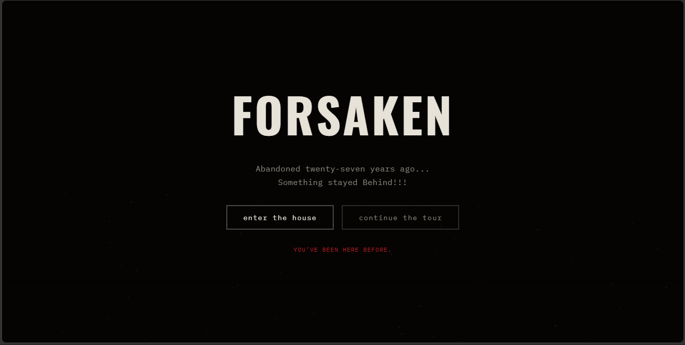

# FORSAKEN

** A haunted house horror game that runs in the browser!!! **

Explore a haunted house! Room by Room! Open doors,read notes,check mirror, listen to the house!! Be carefull of which door to open....

Not every Door is empty in this house.....

---

## What is it??

Forsaken is a first person,point and explore horror game. You explare the rooms of abandoned house! Each room have diffrent scene which you look around by dragging!

What it does:

- Explore every room

- The house changes

- Jumpscare

- secret ending

- Saves your progress

## Hoy to try it

### Online

Use the link:- https://vardaansworld-star.github.io/Forsaken-Game/
To play this game online

### Run by extracting

1. Download ZIP folder from github 
2. Extract the folder
3. Double Click index.html inside folder

## Technologies & Tools

- HTML
- CSS
- Vanilla JavaScript
- Canvas 2D API
- Web Audio API
- localStorage
- Github Pages(For Hosting)

## Else

This is the biggest project I have ever made, and it has all my sweat and blood in it. I wrote the engine and the room system myself.

A lot of late night were spent int his project!

Few thing I am proud of:-

- The rooms are drawn entirely in code. NO IMAGE FILES!!!
- Every sound is GENERATED LIVE (except audio in jumpscare.mp4)
- The house remembers how many times you have visited and changes in response!!!

## Inspiration

Halloween was coming, and want to build something crazy! So i thought of making a horror game, In the browserrrrrrrrrr!!!!

## Preview Image

